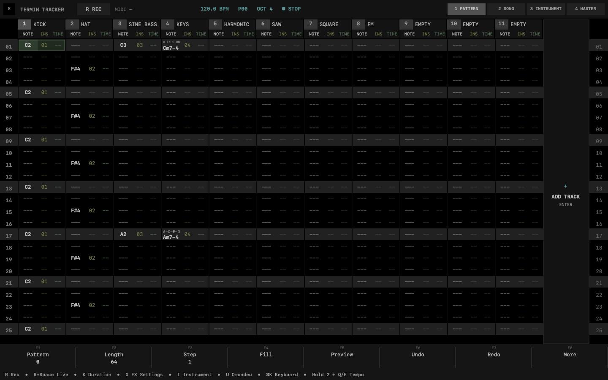
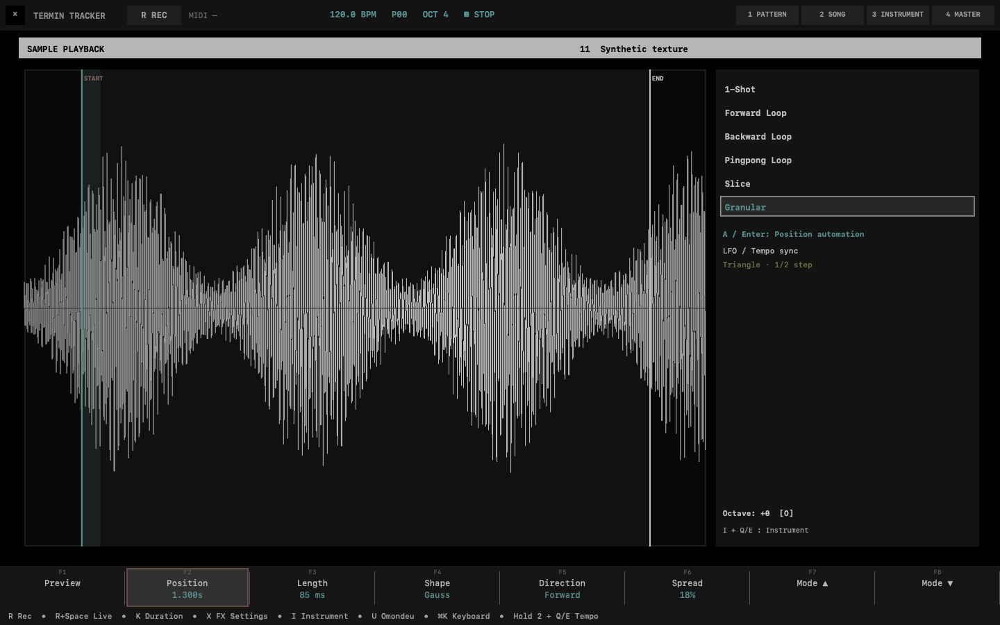
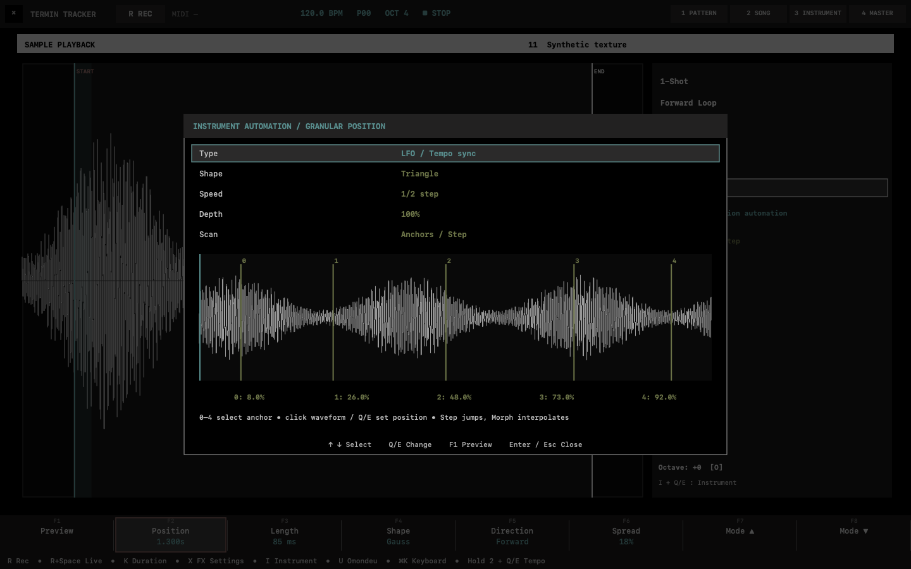
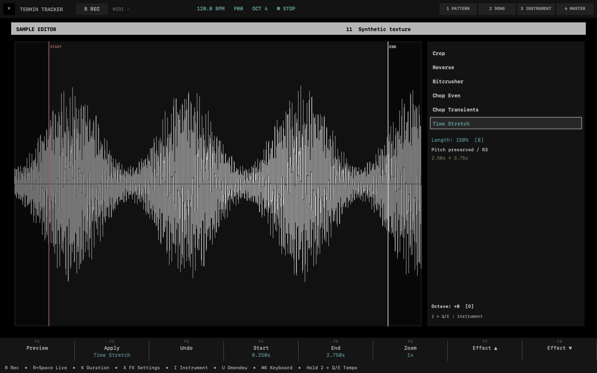
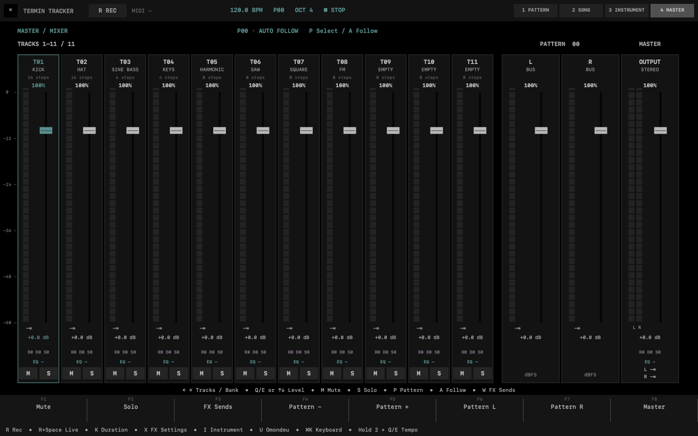
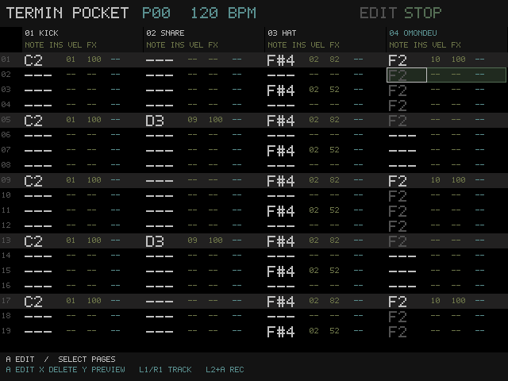
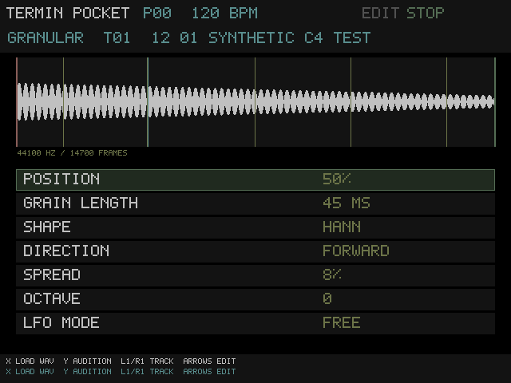
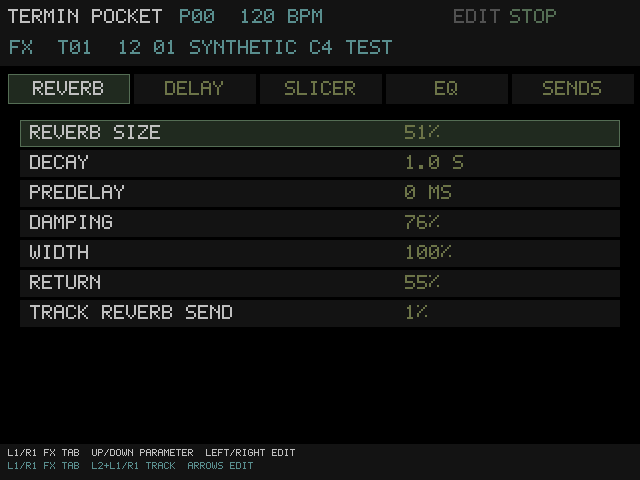

# TERMIN TRACKER

**A compact, keyboard-first music workstation for macOS and retro handhelds.**  
Built for making music without a mouse: write patterns, sculpt sounds, arrange songs and experiment with generative fills. An independent project inspired by the tracker tradition, not affiliated with Polyend.

## Downloads

| Edition | Download | Requirements |
| --- | --- | --- |
| **Termin Tracker 0.19.1** | [macOS universal app (ZIP)](https://github.com/mortingenstrasse/Termin-Tracker/raw/refs/heads/main/downloads/TerminTracker-macOS-0.19.1.zip) | macOS 15+, Apple Silicon or Intel; Intel build not hardware-tested |
| **Termin Tracker Pocket 0.3** | [Knulli ARM64 port (ZIP)](https://github.com/mortingenstrasse/Termin-Tracker/raw/refs/heads/main/downloads/TerminTracker-Pocket-0.3-Knulli.zip) | Anbernic RG35XX Plus, Knulli; experimental handheld beta |

No third-party sample packs are included. Import WAV files you own or are licensed to use. The demos use built-in synthesized instruments; test WAVs are generated temporarily from mathematical signals.

## Two ways to make music

| Feature | macOS | Pocket |
| --- | --- | --- |
| Sequencer | Up to 24 tracks, 128-step patterns | 8 tracks, 128-step patterns |
| Instrument slots | 48 | 48 |
| Polyphonic notes and chords, pattern chaining | Yes | Yes |
| Creative Fill, timing, velocity, note duration | Yes | Simplified fill presets |
| Sampler, slice and granular synthesis | Yes | Yes |
| Granular LFO and five anchor positions | Yes | Yes |
| Omondeu synth | Yes | Yes |
| Reverb, Delay, Slicer, EQ, mixer sends | Yes | Yes |
| Offline pitch-preserving time stretch | Yes, optional Rubber Band CLI | Not yet |
| USB MIDI, computer keyboard instrument, live audio recording, WAV export | Yes | Not yet |

### macOS workflow

1. Unzip the app, move it to Applications and launch it. The app is ad-hoc signed, not notarized. If the Mac blocks it, review its origin and your organization's app policy; building from source is an alternative.
2. Choose **Start Audio**, then New, Load or Demo. Select a track in Pattern and assign an instrument in Instruments (`3`).
3. Toggle REC with `R`. Navigate with arrow keys; press Enter to enter a note or chord. `K` edits note duration. `Cmd+K` enables a playable computer keyboard.
4. Use **Fill** (F4 in Pattern) to generate drum, bass, lead and chord patterns, then shape the mix and effects. Use Song (`2`) to arrange patterns and play the chain.
5. Import audio from Sample Loader (`8`). Choose playback mode in Sample Playback (`9`), or open Sample Editor (`0`) for crop, reverse, chop, bitcrusher and time stretch. The latter requires `rubberband` on the Mac (e.g. `brew install rubberband`); it is not bundled.
6. Press `U` for Omondeu synthesis and `X` for FX. Use Mixer (`4`) for independent track levels, sends, mute/solo and EQ. Save projects and use Song export for WAV output.

#### Granular synthesis

#### Time stretching

#### Mixer

### Pocket workflow — RG35XX Plus

Extract the Knulli ZIP. Copy `TerminPocket.sh`, `TerminPocket.png` and the `terminpocket/` folder into the SD card's `SHARE/roms/ports/` folder. Do not overwrite your existing projects or controller mapping when upgrading. Safely eject the card, boot Knulli and open TerminPocket from Ports. Follow the one-time controller calibration.

| Control | Action |
| --- | --- |
| D-pad (hold to repeat) | Navigate / select / adjust |
| A / B | Confirm or edit / Back |
| X / Y | Delete or browse / Audition |
| L1 / R1 | Track, or FX tab when in FX |
| L2 + A | Toggle REC |
| L2 + D-pad | Adjust value / octave in pattern |
| L2 + X / Y / B | Copy / paste / undo |
| R2 | Pattern actions: Fill, Length, Duration, Tempo, Copy |
| Select / Start | Page chooser / Play or Stop |
| Menu (or L2 + Select) | Home / Continue |

In **Instrument**, select the track with L1/R1, choose an instrument and press A. X opens the folder-based WAV browser. A loads a WAV; Y auditions. Importing a sample assigns it to the selected track. Add your own WAVs beneath `terminpocket/Sample Set/` (subfolders are supported). Open **Granular** from Select and enable it with A, or load directly via X. In **FX**, L1/R1 changes tabs and L2+L1/R1 changes the target track. In **Project**, A saves and Y loads the selected slot.

## Source & build

- [`macOS/`](macOS/) — Swift/AppKit interface and native C++ DSP. On macOS with Xcode Command Line Tools, run `bash macOS/Build.command` (source build targets the local Mac architecture). The script performs workflow and export self-tests.
- [`Pocket/`](Pocket/) — C++17, SDL2 and cJSON. In the ARM64 PortMaster build environment with CMake, a C++ compiler, SDL2, libcjson-dev and Python 3, run `bash Build-Linux.sh` from `Pocket/`. The test suite generates synthetic temporary WAVs and checks browser, sequencing, granular, FX, persistence, and rendering. See [Pocket notes](Pocket/README.md) for further details.

Both editions are experimental. The Pocket ARM64 regression suite passed, and the RG35XX Plus has been used for direct testing; performance on other handhelds and exact real-time audio latency are not guaranteed. Pocket projects with more than eight tracks are not supported, and not all desktop-only settings round-trip.

## Credits and licensing

Designed by Tunç Alıcıoğlu with AI-assisted implementation. Independent software; not a Polyend product or firmware distribution. SDL2 and cJSON are third-party dependencies; cJSON's license accompanies the Pocket binary. Rubber Band is a separately installed optional dependency on macOS. No commercial sample library, personal recordings, or user projects are distributed.

Source is available for inspection. An explicit project-wide redistribution license has not yet been selected; please do not assume a license for redistribution or commercial reuse. Feedback and bug reports are welcome via Issues.
